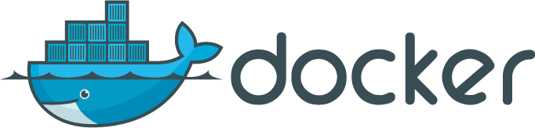

<center style="margin-top: 28px; margin-bottom: 23px">

</center>

## Docker Integration

Using Containers? We got your back. Start today using **pm2-runtime**, a perfect companion to get the most out of Node.js in production environment.

The goal of pm2-runtime is to wrap your applications into a proper Node.js production environment. It solves major issues when running Node.js applications inside a container like:

- Second Process Fallback for High Application Reliability
- Process Flow Control
- Automatic Application Monitoring to keep it always sane and high performing
- Source Map Support (native Node.js source maps enabled by default)

Further than that, using PM2 as a layer between the container and the application brings PM2 powerful features like [application declaration file](/docs/usage/application-declaration/), [customizable log system](/docs/usage/log-management/) and other great features to manage your Node.js application in production environment.

## Use PM2 inside Containers

In your Dockerfile add this line to install PM2:

```
RUN npm install pm2 -g
```

Then replace the `node` binary with `pm2-runtime` 

```
CMD ["node", "app.js"]
```

to:

```
CMD ["pm2-runtime", "app.js"]
```

**You are now all set!** Your Node.js application is now wrapped into a proper Node.js production environment.

### Official images

Instead of installing PM2 yourself, you can start from the [keymetrics/pm2](https://hub.docker.com/r/keymetrics/pm2) images, which ship Node.js and PM2 ready to use:

```
FROM keymetrics/pm2:24-alpine

WORKDIR /app
COPY package.json .
RUN npm install --production
COPY . .

CMD ["pm2-runtime", "start", "ecosystem.config.js"]
```

Tags follow the `<node>-<variant>` pattern, for `linux/amd64` and `linux/arm64`:

- **Node.js**: `22`, `24`, `26` or `latest` (newest Node.js release)
- **Variant**: `alpine`, `bookworm`, `trixie` or `slim`, on top of the [official Node.js images](https://hub.docker.com/_/node)
- **Hardened**: `22-hardened`, `24-hardened`, `26-hardened`, based on [Docker Hardened Images](https://docs.docker.com/dhi/) (non-root, no shell, near-zero CVEs)
- **Bun**: `bun` and `bun-alpine`, to run PM2 and your applications on [Bun](https://bun.sh)

Images are rebuilt every week to pick up Node.js security updates, and on every PM2 release. See the [docker-pm2 repository](https://github.com/keymetrics/docker-pm2) for the full tag list and usage of the hardened images.

### Starting a configuration file

Instead of running your raw Node.js application with PM2, you can declare it into a configuration file (or process file) and set some configuration variables, like enabling the cluster mode.

Let's create a ecosystem.config.js file with this content:

```javascript
module.exports = [{
  script: 'app.js',
  name: 'app',
  exec_mode: 'cluster',
  instances: 2
}, {
  script: 'worker.js',
  name: 'worker'
}]
```

All options available are [listed here](/docs/usage/application-declaration/#attributes-available).

You can then replace the **CMD** directive by this:

```
CMD ["pm2-runtime", "ecosystem.config.js"]
```

To split each processes in its own Docker, you can use the --only [app-name] option:

```
CMD ["pm2-runtime", "ecosystem.config.js", "--only", "APP"]
```

### Using exec_mode cluster together with nuxtjs

When running pm2 in cluster mode, `ecosystem.config.js` will be appended to your cwd path due to how nuxtjs parses its rootDir, to fix that you have to specify the config path in your args section:

```javascript
module.exports = {
  apps: [
    {
      name: 'my-nuxtjs-app',
      exec_mode: 'cluster',
      instances: 2,
      cwd: '/var/www',
      script: './node_modules/nuxt-start/bin/nuxt-start.js',
      args: '-c /var/www/nuxt.config.js'
    }
  ]
}
```

### Logging Format option

If you want to change the log output format you can select one of this options:

- **--json**: will output logs in JSON format (logstash)
- **--format**: will output logs in = style format
- **--formatted**: will output logs prefixed with `|id|app|`
- **--raw**: will output logs as is (default)

To use one of this flag, you just need to pass them to pm2-runtime:

```
CMD ["pm2-runtime", "--json", "ecosystem.config.js"]
```

### Enabling Graceful Shutdown

When the Container receives a shutdown signal, PM2 forwards this signal to your application allowing to close all the database connections, wait that all queries have been processed or that any other final processing has been completed before a successful graceful shutdown.

Catching a shutdown signal is straightforward. You need to add a listener in your Node.js applications and execute anything needed before stopping the app:

```javascript
process.on('SIGINT', function() {
   db.stop(function(err) {
     process.exit(err ? 1 : 0);
   });
});
```

By default PM2 will wait 1600ms before sending a final SIGKILL signal. You can modify this delay by setting the `kill_timeout` option inside your application configuration file.

Read more about application state management [here](/docs/usage/signals-clean-restart/)

### Development environment

You may want to tell Developers to program inside a container to keep a consistent environment between development, test and production.

Replacing **pm2-runtime** with **pm2-dev** will enable the watch and restart features. This is quite interesting in a development container when the host files are exposed to the container as a VOLUME.

### Using PM2.io

[PM2.io](https://pm2.io/) is a monitoring service built on top of PM2 that allows to monitor and manage applications easily (logs, restart, exceptions monitoring...). Once you created a Bucket on PM2.io you will get a public and a secret key.

To enable PM2.io monitoring with **pm2-runtime**, you can either use the CLI option **--public XXX** and **--secret YYY** or pass the environment variables **PM2_PUBLIC_KEY** and **PM2_SECRET_KEY**.

Example with the CLI options via a Dockerfile:

```
CMD ["pm2-runtime", "--public", "XXX", "--secret", "YYY", "ecosystem.config.js"]
```

Or via environment variables:

```
ENV PM2_PUBLIC_KEY=XXX
ENV PM2_SECRET_KEY=YYY
```

Or via the Docker run command:

```
docker run --net host -e "PM2_PUBLIC_KEY=XXX" -e "PM2_SECRET_KEY=XXX" <...>
```

## pm2-runtime Helper

Here is the pm2-runtime helper:

```
>>> pm2-runtime -h

  Usage: pm2-runtime app.js

  pm2-runtime is a drop-in replacement Node.js binary for containers

  Options:

    -V, --version                      output the version number
    -i --instances <number>            launch [number] of processes automatically load-balanced. Increase overall performances and performance stability.
    --secret [key]                     [MONITORING] PM2 plus secret key
    --no-autostart                     add an app without automatic start
    --no-autorestart                   start an app without automatic restart
    --stop-exit-codes <exit_codes...>  specify a list of exit codes that should skip automatic restart
    --node-args <node_args>            space delimited arguments to pass to node in cluster mode - e.g. --node-args="--debug=7001 --trace-deprecation"
    -n --name <name>                   set a <name> for script
    --max-memory-restart <memory>      specify max memory amount used to autorestart (in octet or use syntax like 100M)
    -c --cron <cron_pattern>           restart a running process based on a cron pattern
    --interpreter <interpreter>        the interpreter pm2 should use for executing app (bash, python...)
    --public [key]                     [MONITORING] PM2 plus public key
    --machine-name [name]              [MONITORING] PM2 plus machine name
    --trace                            enable transaction tracing with km
    --v8                               enable v8 data collecting
    --format                           output logs formated like key=val
    --raw                              raw output (default mode)
    --formatted                        formatted log output |id|app|log
    --json                             output logs in json format
    --delay <seconds>                  delay start of configuration file by <seconds> (default: 0)
    --web [port]                       launch process web api on [port] (default to 9615)
    --only <application-name>          only act on one application of configuration
    --no-auto-exit                     do not exit if all processes are errored/stopped or 0 apps launched
    --env [name]                       inject env_[name] env variables in process config file
    --watch                            watch and restart application on file change
    --error <path>                     error log file destination (default disabled) (default: /dev/null)
    --output <path>                    output log file destination (default disabled) (default: /dev/null)
    --deep-monitoring                  enable all monitoring tools (equivalent to --v8 --event-loop-inspector --trace)
    -h, --help                         output usage information

  Commands:

    *
    start <app.js|json_file>           start an application or json ecosystem file
```
